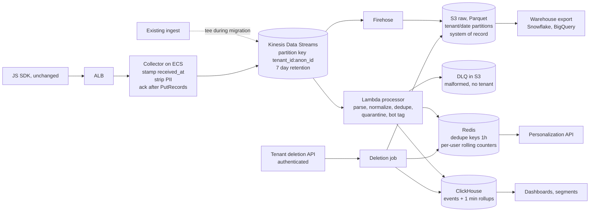

# Beat Claude: Engineer 004, Real-Time Analytics Pipeline

- **Candidate:** David Davieson
- **Brief version: 2026-07**
- **Fixture:** `fixtures/event_sample.jsonl`, sha256 `1aeb24b415009e89fcf8acb5a178410faf216dc17b16920d9849ecc8bbb24235` (as published, LF line endings), from beat-claude commit `4b719e4`
- **Repo:** https://github.com/nuroctane/beat-claude-engineer-004
- **Interactive report:** https://beat-claude-engineer-004.civetadeicollegium.workers.dev
- **Length:** section 1 is the written answer, inside four pages with the diagram. Sections 2 to 8 are the required packet items.

---

## 1. Written answer

### The short version

Kinesis in front, S3 as the system of record, Lambda for validation and dedupe, Redis for the personalization hot path, ClickHouse for dashboards and segments. Migration is a tee from the existing ingest into the new stream, a parallel run with a per-tenant count diff, and a per-tenant flag as the rollback. It costs about $11.7K a month [Estimated], so the old pipeline can keep running beside it the whole time without breaking the $50K ceiling.

What I'm optimizing for: two engineers can build it in three months and operate it without a platform team. What I'm giving up: exactly-once end to end, sub-second dashboards, and a single vendor.

### Architecture



| Layer | Choice | Over | Why, in this brief's terms |
|---|---|---|---|
| Buffer | Kinesis Data Streams, provisioned | MSK, SQS | MSK is the better log, but brokers, partitions and upgrades are a real job for a team of two. SQS has no replay and no per-key ordering. Kinesis gives 7 days of replay and needs about 9 shards [Estimated] at design peak. |
| Archive | Firehose to S3 Parquet | Writing straight to the database | Replay, backfill and warehouse export all come from one immutable copy. If a processor bug ships, I reprocess from S3 instead of explaining loss to customers. Snowflake reads it through an external stage, BigQuery through its S3 transfer service. |
| Processing | Lambda on the Kinesis trigger | Managed Flink, KCL on ECS | The logic is per-event plus a dedupe lookup. Stateful windows aren't needed for MVP because ClickHouse does the rollups. The team writes Python already. Flink is where I'd go if session-window segments move into the stream. |
| Hot path | Redis (already in the stack) | DynamoDB | Personalization needs "this visitor, last N minutes" in milliseconds. Rolling counters per (tenant, identity) are a natural Redis shape and the team already runs it. |
| Analytics | ClickHouse (managed, on AWS) | Postgres, Redshift, Druid/Pinot | Postgres won't hold 1.5B rows a month [Estimated] of ad hoc group-bys. Redshift streaming works but the latency and concurrency for 500 tenants clicking dashboards costs more. Druid and Pinot fit the workload but are too much to operate for two people. |

**Event model.** One envelope: `tenant_id, event_id, anonymous_id, user_id, type, ts, received_at, schema_version, properties`. Idempotency key is `(tenant_id, event_id)`. The partition key is `tenant_id:anonymous_id`, which keeps one visitor ordered and spreads big tenants across shards.

**Identity.** `identify` events write `(tenant, anonymous_id) -> user_id` to a mapping table (Postgres, mirrored to Redis). Events are never rewritten. Stitching happens at query time through a ClickHouse dictionary, so a late identify retroactively attributes earlier anonymous history without touching stored rows. Every key is tenant-scoped: the same `anon-*` in two tenants is two people.

**Latency budget.** SDK to collector about 0.2s [Observed] (in the fixture: `received_at - ts` is 0.13 to 0.21s on clean events, which also folds in client clock offset, so it's a rough figure), Kinesis to Lambda with a 1s batch window about 1.5s [Estimated], ClickHouse async insert about 1s [Estimated], dashboard poll 2s [Assumed]. About 4.7s [Estimated] end to end, which is tight against the 5s target. The personalization path skips ClickHouse and lands in Redis in about 2s [Estimated].

### Scale, reliability and migration

**Sizing.** 50M a day [Observed] (brief) is 579 events/s on average [Estimated]. Ten times that plus 1.5x headroom [Assumed] is about 8,700/s [Estimated]: 9 shards at 1,000 records/s each [Benchmarked] (AWS shard limit). If the 10x spike applies to the daily peak instead of the average, it's about 27 shards [Estimated] (assuming the peak hour runs 3x the average), about $460 a month more [Estimated], computed in `cost_model.py`. I'd provision for that before the first Black Friday rather than trust autoscaling during one.

**Delivery guarantee, stated precisely.** From the moment the collector gets a successful `PutRecords`, it's at-least-once. Successful means `FailedRecordCount` is zero, not HTTP 200: the call returns 200 even when some records in the batch were throttled, so the collector retries just the failed entries before it acks. From there, aggregates are effectively once through the dedupe on `(tenant_id, event_id)`. Before that ack I can't promise anything, because I can't change the SDK. The fixture suggests it does retry (`evt-0002` arrives twice, 7.4s apart [Observed], reproduce with `detect.py`), so the collector returns 503 on any Kinesis failure and lets the client retry instead of acking and hoping. The Redis dedupe window is 1 hour [Assumed]: the fixture's retry landed 7.4s later, and a 24-hour window would need about 13.5GB [Estimated] on a 3x day, more than the node holds. Anything later, or lost in a Redis failover, collapses in ClickHouse, which stores events in a ReplacingMergeTree keyed on `(tenant_id, event_id)`. Merges are eventual, so queries that need an exact count read with `FINAL`.

**What degrades first under overload:** personalization stops evaluating bot-tagged traffic, which costs customers nothing. Then dashboard freshness, through bigger batches. Raw capture never degrades. Kinesis holds 7 days, so a slow consumer means lag, not loss.

**Detecting loss instead of assuming it away.** Each collector counts accepted events per tenant per minute. A reconciliation job every hour compares collector counts, Kinesis `IncomingRecords`, S3 rows and ClickHouse rows. Any gap over 0.1% [Assumed] (threshold) pages someone. The current 3% loss [Observed] (brief) has never been measured per stage. This makes it measurable.

**Migration (no SDK change, no broken integrations):**

| Weeks | Step | Customer-visible | Rollback |
|---|---|---|---|
| 1 to 4 [Assumed] | Stand up Kinesis, Firehose, S3. Existing ingest tees every event to Kinesis behind a per-tenant flag, through the same PII scrubber the collector will use, so phase one doesn't put raw PII in the new log. | Nothing | Turn the tee off |
| 5 to 8 [Assumed] | Processor and ClickHouse. Daily parallel-run diff per (tenant, type, hour). | Nothing | Nothing to roll back |
| 9 to 12 [Assumed] | MVP: real-time dashboards behind a per-tenant flag. 5 design partners [Assumed], then 10%, 50%, 100%. | New dashboards | Flip the flag; the old pipeline never stopped |
| Months 4 to 6 [Assumed] | New collector takes the SDK hostname by weighted DNS, 1% to 100%. Warehouse export, segment triggers. Old pipeline off 30 days [Assumed] after the last clean diff. | Faster everything | DNS weight back to the old ingest |

**The MVP leaves out** warehouse export, behavior-triggered personalization and the new collector. It ships the archive, the processor and real-time dashboards, which is the complaint customers are actually making.

**"Data accuracy verified" means**, per tenant, for 14 straight days [Assumed]: compare distinct `(tenant_id, event_id)` at the raw layer on both sides, never dashboard totals, because the old system may count SDK retries twice and the new one drops bots and quarantined rows from aggregates. On that basis: new >= old for every (type, hour), the DLQ rate is under 0.1% [Assumed], and a sample of 1,000 event_ids [Assumed] traced from S3 to ClickHouse with zero missing. Distinct new lower than distinct old is always a bug in the new system. One honest limit: while the tee sits inside the old ingest, anything lost before the tee is invisible to both sides. The old system's true loss only shows up once the new collector takes traffic in months 4 to 6 [Assumed].

**Automatic rollback triggers:** any tenant-hour where new < old by more than 1% [Assumed], p95 latency over 5s for 15 minutes [Assumed], and any row whose tenant_id doesn't match its partition (cross-tenant leak, roll back first, investigate second).

**Compliance as layout.** PII is stripped or hashed at the collector, before the log (see `evt-0007`). Everything is partitioned by tenant, so offboarding is a partition drop, and a ClickHouse row policy keeps each tenant's queries inside its own rows. Deletion comes in only through an authenticated tenant API. The job walks the identity graph, deletes in Redis right away, runs a ClickHouse lightweight delete, and rewrites affected S3 Parquet partitions in a weekly compaction, inside GDPR's one month [Benchmarked] (Art. 12(3)), which also covers CCPA's 45 days [Benchmarked] (Cal. Civ. Code 1798.130). A suppression list filters reads in the meantime. Anonymous history on a shared device is held for a person, never deleted on a guess. Copies a customer already exported to their own warehouse are theirs; the job sends them a signed deletion notice. SOC 2 is mostly evidence: KMS encryption at rest, CloudTrail and ClickHouse query logs for access, CI gates as change control.

### What the fixture actually contains

`python detect.py fixtures/event_sample.jsonl` reproduces all of this. 25 lines [Observed], 24 parse [Observed], 23 unique [Observed], 11 clean [Observed]. Every finding carries the action the pipeline takes: quarantine, compliance, repair, exclude, alert or info.

| Anomaly class | event_id | What's there | How the pipeline handles it |
|---|---|---|---|
| Duplicate retry | evt-0002 (lines 2, 5) | Same payload, received 7.4s apart [Observed] | Dedupe on (tenant_id, event_id), first copy wins, the retry is counted |
| Client clock ahead | evt-0005, evt-0006 | ts 47s and 65 min after receipt [Observed] | Bucket on received_at past 5s [Assumed] tolerance; keep client ts as an attribute |
| Implausible timestamp | evt-0016 | ts in 2027, received 2026 [Observed] | Same rule. The same user's evt-0024 is fine, so this is one bad event, not a bad device |
| PII in properties | evt-0007 | Email and phone in a custom event | Hash or drop at the collector. anon-3d0 later identifies as u-7304 (evt-0022), so this PII becomes attached to a known person |
| Legacy SDK schema | evt-0009 | `pageview`, `timestamp`, `page_path`, `ref`, no received_at | Versioned mapping table. Rejecting old SDKs is data loss you've chosen |
| Missing tenant | evt-0011 | tenant_id null | Quarantine. No tenant means no retention policy and no deletion owner |
| Bot traffic | evt-0012 to evt-0015 | 4 page views in 50ms [Observed], scanner referrer | Keep raw, tag is_bot, exclude from dashboards, segments and triggers |
| Privacy request via SDK | evt-0017 | GDPR delete for u-1077 sent as an analytics event | Route to compliance, don't execute. Verified scope includes anon-77a, so evt-0006 too |
| Client-computed counter | evt-0019 | Client says 3 pricing views [Observed]; the sample shows 1, evt-0001 [Observed] | Store, never segment on it. "Viewed pricing 3x" is computed server-side |
| Malformed JSON | evt-0020 | Missing closing brace | DLQ the raw bytes with tenant hint, rate-alert per tenant |

**Things I would not act on at face value:**

1. **evt-0017's deletion request.** Anyone with a browser console can send it. Executing it means anyone can wipe any user's history. It's a signal to open a verified request, not the request itself.
2. **evt-0019's `count_today: 3`.** The mismatch with the one observed pricing view doesn't prove the client is wrong, since this is a 25-row slice. It does prove the number can't drive a personalization trigger.
3. **The bot verdict on anon-8fc.** A burst plus a scanner referrer is a strong heuristic, not proof. It could be a customer's own uptime monitor. Tag and exclude, never delete.
4. **evt-0006's timestamp.** The skew is exactly 1h05m with matching milliseconds [Observed], which looks like a timezone bug more than drift. I'd want 10,000 events from that SDK version before writing a correction rule. Until then, received_at.
5. **Any loss or bot rate from this sample.** 4 of 23 unique events are bot-tagged [Observed]. Calling that "17% bot traffic" from 25 rows would be making it up.

### Trade-offs, risks, and what I'd do with more

- **Lambda's ceiling.** One concurrent invocation per shard caps throughput. If a big tenant gets hot, I'd turn on enhanced fan-out and parallelization factor, then move to Flink.
- **ClickHouse is the one new database.** It's the risk I'd spend the first spike week on: load-test the rollup queries at 3x [Assumed] the expected tenant concurrency before committing.
- **The 4.7s budget is thin.** If the dashboard p95 misses 5s, the honest fix is to serve "last 60 seconds" tiles from Redis and keep ClickHouse for everything older.
- **At half the budget** ($25K [Assumed]), the new pipeline and a $15K [Assumed] old one don't both fit. I'd run shadow mode in two-week cohorts instead of all tenants at once, and start ClickHouse on one replica.
- **More budget:** MSK plus Flink for true stateful segments, and a second region for the collector. **More time:** server-side identity resolution with merge history and a schema registry with contract tests against every SDK version in the field.

---

## 2. Operating artifact

A runnable repo, stdlib Python 3.10 or newer, no installs. Test count below is [Observed] from the run:

- `detect.py`: the processor's validation stage run against the fixture. Parse, normalize, dedupe, quarantine, flag, identity graph, deletion scope. One bad line never stops the batch: bad encoding, non-object JSON, naive or epoch timestamps, missing or malformed ids each get their own class. PII is masked in every output, including names caught by key alone. `--fail-on compliance` gives a nonzero exit for CI, and `--check-upstream` confirms the live challenge fixture hasn't rotated.
- `tests/test_detect.py`: 45 tests [Observed]. Pins the fixture checksum, asserts every seeded class with exact event_ids and no false positives on the 11 clean events, proves no PII reaches any output, and covers the edge cases a real stream throws (CRLF copies, BOMs, dates that look like phone numbers, `email_campaign_id` that isn't an email, `robotics.com` that isn't a bot, integer user ids, a shared device in a deletion request).
- `cost_model.py`: sizing and monthly cost with every input labeled. Change one, rerun. `tests/test_cost_and_site.py` checks the shard math covers both Kinesis limits, the dedupe window fits in Redis, and the totals add up.
- `site/`: the interactive report, built from the same detector and cost model output, so the page can't drift from the code.
- `SUBMISSION.pdf`: this packet for upload, rendered by `render_assets.py`. Section 1 fills pages 1 to 4.
- `.github/workflows/ci.yml`: tests on Python 3.10 to 3.13, a fixture rotation check, and this packet through the challenge's own validator in strict mode.

## 3. Evidence log

| Claim | Tier | Proof |
|---|---|---|
| The fixture contains the anomalies listed, by event_id | Tier 3 | `python detect.py fixtures/event_sample.jsonl`, raw records in `fixtures/`, every row inspectable in the interactive report |
| The detector catches them with no false positives on clean events | Tier 2 | `python -m unittest discover -s tests -v`, 54 pass across detector, cost model and page, also run in CI |
| 9 to 27 Kinesis shards cover the 10x spike | Tier 2 | `python cost_model.py`, shard limits from AWS docs |
| New pipeline costs about $11.7K a month, under $50K with the old one still running | Tier 2 | `python cost_model.py`. Kinesis, Firehose, Fargate and Redis unit prices checked against the AWS pricing pages on 2026-10-22, linked in the file. ClickHouse, about half the total, is still an estimate, not a quote |
| `PutRecords` returns HTTP 200 even when records in the batch failed | Tier 3 | AWS API reference, including a sample 200 response with `FailedRecordCount: 2`: https://docs.aws.amazon.com/kinesis/latest/APIReference/API_PutRecords.html |
| End-to-end latency under 5s | Tier 0 | Budget arithmetic only. Not load-tested. First thing I'd prove in week 5 |
| Zero loss after ack | Tier 0 | Design argument. The reconciliation job is how it becomes Tier 3 |
| Comparable production experience: 40+ pipelines, 99.95% SLO, MTTR from 4 hours to under 45 minutes at Capital One [Observed] (my own work) | Tier 0 | Employer-confidential, nothing shareable. Happy to walk through how those were measured live |

## 4. Number source labels

Every number above carries a label in place. Sizing and cost inputs are labeled line by line in `cost_model.py`. Fixture counts are [Observed] and reproducible with `detect.py`. Thresholds (5s skew tolerance, 0.1% reconciliation gap, 1% rollback trigger, 14-day verification window) are [Assumed] starting points I'd tune against real data in the parallel run.

## 5. AI usage disclosure

- **Tools:** an AI coding agent running in my terminal.
- **What it did:** most of the build. It picked Engineer 004 as the engineering brief, drafted the architecture and its trade-offs, wrote `detect.py`, the tests, `cost_model.py`, the report site, the PDF renderer, CI and this document, and checked the AWS facts and unit prices the cost model leans on. It also ran the four review passes I asked for, which found and fixed real bugs, including PII leaks in its own first drafts.
- **What I directed:** taking the challenge on, how deep each review pass went, the report's design direction (the monochrome glass look from my own site), and publishing the repo and report.
- **What I checked:** I read all 25 fixture lines against the anomaly table, ran `detect.py` and the tests myself, and redid the shard and dedupe math by hand. Then I read this packet and the live report end to end. Kinesis over MSK, Lambda over Flink and ClickHouse for analytics are calls I'd defend live. The tee-and-flag migration is the agent's plan. It reads right to me, but it's the part I'd pressure-test with someone who's run a cutover like this before I'd call it mine.
- **Known weak spots:** ClickHouse and the transfer, observability and export lines are estimates, not quotes. Latency is unmeasured. The bot and PII detectors are heuristics tuned on 25 rows [Observed].

## 6. Failure handling: what breaks it

| Failure | Detection | Response |
|---|---|---|
| The SDK doesn't actually retry on 503 | Collector 503 count vs. later duplicate arrivals | Without retries, pre-ack loss is unrecoverable. Make the collector's Kinesis path boringly reliable (multi-AZ, aggressive local retry) |
| One huge tenant creates a hot shard | Per-shard `WriteProvisionedThroughputExceeded` | Add a salt to that tenant's partition key; ordering per visitor survives |
| A new SDK build ships a broken payload | Per-tenant DLQ rate alert | DLQ keeps raw bytes, fix the mapping, replay from DLQ |
| ClickHouse falls behind | Kinesis iterator age | Dashboards go stale, raw is safe in S3, replay once it catches up |
| Identity graph is wrong (shared devices) | One anonymous id identified as two users (`ANON_MULTI_USER`) | Keep the history, never auto-merge two known user_ids, and hold that device's anonymous events out of any deletion until a person decides |
| A deletion misses a store | Weekly audit: suppression list vs. all stores | Deletion job is idempotent; rerun it |
| Cost assumptions are wrong | Monthly bill vs. `cost_model.py` | ClickHouse is about half the bill [Estimated]; resize there first |

## 7. What stays human

- **Executing a deletion.** A person at the tenant confirms through the authenticated API. The pipeline never deletes on the strength of an event.
- **The cutover decision per tenant.** The diff report recommends; an engineer signs off, because "new has 2.8% more events" [Assumed] (a hypothetical diff) is either the old loss or a new duplicate bug, and telling them apart takes reading samples.
- **Bot and PII rules.** Heuristics flag. A person approves a new exclusion rule, because a bad one silently removes a customer's real traffic from their dashboards.
- **Anything that crosses tenants.** Any cross-tenant query, backfill or schema change gets a second reviewer.

## 8. Artifact access

No login, no keys, no cloud account.

```
git clone https://github.com/nuroctane/beat-claude-engineer-004
cd beat-claude-engineer-004
python detect.py fixtures/event_sample.jsonl
python -m unittest discover -s tests -v
python cost_model.py
```

Or open the interactive report at https://beat-claude-engineer-004.civetadeicollegium.workers.dev: every fixture line, its findings, and the cost model, no install.

`fixtures/event_sample.jsonl` is a byte-exact copy of the public beat-claude fixture, pinned with `.gitattributes` so a Windows checkout can't rewrite its line endings. `detect.py` prints whether your copy matches and hashes CRLF copies as LF, so the check holds either way.
