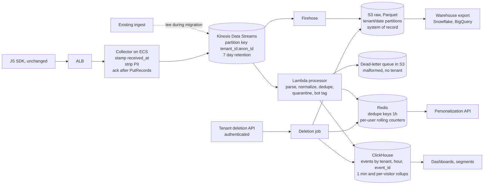

# Beat Claude: Engineer 004, Real-Time Analytics Pipeline

- **Candidate:** David Davieson
- **Brief version: 2026-07**
- **Fixture:** `fixtures/event_sample.jsonl`, sha256 `1aeb24b415009e89fcf8acb5a178410faf216dc17b16920d9849ecc8bbb24235` (as published, LF line endings), from beat-claude commit `4b719e4`
- **Repo:** https://github.com/nuroctane/beat-claude-engineer-004
- **Interactive report:** https://beat-claude-engineer-004.civetadeicollegium.workers.dev
- **Length:** section 1 is the written answer, inside four pages with the diagram. Sections 2 to 8 are the required packet items.

## 1. Written answer

### The short version

Kinesis in front, S3 as the system of record, Lambda for validation and dedupe, Redis for the personalization hot path, and ClickHouse for dashboards and segments. Migration tees the existing ingest into the new stream, diffs the two per tenant, and uses a per-tenant flag as the rollback. It costs about $8.0K a month [Estimated], so the old pipeline can run beside it the whole time under the $50K ceiling.

I'm optimizing for two engineers building it in three months and running it without a platform team. I'm giving up exactly-once delivery end to end, sub-second dashboards and a single vendor.

### Architecture



| Layer | Choice | Over | Why, in this brief's terms |
|---|---|---|---|
| Buffer | Kinesis Data Streams, provisioned | Amazon MSK (managed Kafka), SQS | Kafka is the better log, but brokers and upgrades are a real job for two people. SQS has no replay and no per-key ordering. Kinesis gives 7 days of replay on 9 shards [Estimated]. |
| Archive | Firehose to S3 as Parquet | Writing straight to the database | Replay, backfill and warehouse export all read one immutable copy. Snowflake reads it through an external stage and BigQuery through its S3 transfer service. |
| Processing | Lambda on the Kinesis trigger | Managed Flink, KCL on ECS | The logic is per-event plus a dedupe lookup, and ClickHouse does the windowing. The team already writes Python. Flink comes in once session windows move into the stream. |
| Hot path | Redis, already in the stack | DynamoDB | "This visitor in the last N minutes" in milliseconds is a natural Redis counter, and the team already runs it. |
| Analytics | ClickHouse Cloud on AWS | Postgres, Redshift, Druid, Pinot | Postgres won't take 1.5B rows a month [Estimated] of ad hoc group-bys. Redshift costs more to serve 500 tenants' dashboard clicks. Druid and Pinot are too much to operate for two people. |

**Events and identity.** One envelope: `tenant_id, event_id, anonymous_id, user_id, type, ts, received_at, schema_version, properties`, keyed for idempotency on `(tenant_id, event_id)`. Kinesis partitions on `tenant_id:anonymous_id` to keep each visitor in order. An `identify` writes `(tenant, anonymous_id) -> user_id` to Postgres, mirrored to Redis, and a ClickHouse dictionary stitches at query time, so a late identify claims earlier anonymous history without rewriting a row. Keys are tenant-scoped.

**Latency budget.** About 3.9s [Estimated] against the 5s target: 0.2s SDK to collector [Observed] (fixture `received_at - ts`), 1.5s Kinesis to Lambda [Estimated], 1.2s to queryable in ClickHouse at p95 [Observed] (benchmark below), and a 1s tile poll [Assumed]. A 2s poll would make it 4.9s, and the tile query only costs 117 ms [Observed]. Personalization skips ClickHouse and reaches Redis in about 2s [Estimated].

### Scale, reliability and migration

**Sizing.** 50M events a day [Observed] (brief) averages 579 per second [Estimated]. Ten times that plus 1.5x headroom [Assumed] is about 8,700 per second [Estimated], which needs 9 Kinesis shards at 1,000 records per second each [Benchmarked] (AWS limit). If the spike lands on a busiest hour running 3x the average [Assumed], it's 27 shards [Estimated] and about $460 more a month [Estimated]. I'd provision that before the first Black Friday rather than trust autoscaling during one.

**Delivery guarantee.** At-least-once from the moment `PutRecords` succeeds, which means `FailedRecordCount` is zero. HTTP 200 isn't enough, since Kinesis returns it even when it throttled part of the batch. The collector retries failed entries and only then acks the SDK. Before the ack I can't promise anything without changing the SDK. The fixture suggests it retries (`evt-0002` arrives twice, 7.4s apart [Observed], per `detect.py`), so any Kinesis failure returns 503.

**Dedupe.** Redis holds keys for 1 hour [Assumed], since 24 hours would need about 13.5GB [Estimated] on a 3x day, more than an r7g.large holds. ClickHouse backs it up with a ReplacingMergeTree keyed on tenant, hour and `event_id`. The benchmark found the edges (`bench/results.json`). 423 of 249,339 retries [Observed] straddled an hour and survived the merge, so reconciliation counts distinct `event_id`. The 1-minute rollup counted 242,007 retries [Observed], because a materialized view sees inserts before any merge. Dedupe has to happen in Redis first.

**Overload and loss.** Bot-tagged personalization sheds first, which costs customers nothing, then dashboard freshness. Raw capture never degrades, and Kinesis holds 7 days, so a slow consumer means lag, not loss. Hourly, a reconciliation job compares collector counts, Kinesis `IncomingRecords`, S3 rows and distinct ClickHouse events per tenant, and pages at a gap over 0.1% [Assumed]. Today's 3% loss [Observed] (brief) has never been measured per stage. This shows where it happens.

**Migration.** No SDK change and no broken integrations:

| Weeks | Step | Customer-visible | Rollback |
|---|---|---|---|
| 1 to 4 [Assumed] | Stand up Kinesis, Firehose and S3. The existing ingest tees every event into Kinesis behind a per-tenant flag, through the collector's PII scrubber. | Nothing | Turn the tee off |
| 5 to 8 [Assumed] | Processor and ClickHouse run dark. A daily diff compares distinct events per tenant, type and hour. | Nothing | Nothing to roll back |
| 9 to 12 [Assumed] | MVP: real-time dashboards behind a per-tenant flag. 5 design partners [Assumed], then 10%, 50% and 100%. | New dashboards | Flip the flag. The old pipeline never stopped |
| Months 4 to 6 [Assumed] | The new collector takes the SDK hostname by weighted DNS. Warehouse export and segment triggers ship. The old pipeline turns off 30 days [Assumed] after the last clean diff. | Faster everything | Shift DNS weight back |

The MVP leaves out warehouse export, behavior-triggered personalization and the new collector. It ships what customers are complaining about: real-time dashboards.

**"Data accuracy verified"** means distinct `(tenant_id, event_id)` match at the raw layer, per tenant, for 14 straight days [Assumed]. Dashboard totals don't count, since the old system may count retries twice. New must be at least old for every type and hour, dead-letters under 0.1% [Assumed], and 1,000 sampled event_ids [Assumed] traceable from S3 to ClickHouse. The limit is that loss before the tee is invisible to both sides until the new collector takes traffic.

**Rollback triggers** fire on any tenant-hour where new falls more than 1% [Assumed] below old, on p95 latency over 5s for 15 minutes [Assumed], and on any row whose tenant_id doesn't match its partition. That last one is a cross-tenant leak, so roll back first and investigate second.

**Compliance as layout.** Personal data (PII) is stripped or hashed at the collector, before the log. Partitioning by tenant makes offboarding a partition drop, and a ClickHouse row policy keeps each tenant in its own rows. Deletion comes only through an authenticated tenant API. The job walks the identity graph, clears Redis right away, runs a ClickHouse lightweight delete and compacts S3 weekly, inside GDPR's one month [Benchmarked] (Art. 12(3)) and CCPA's 45 days [Benchmarked] (Cal. Civ. Code 1798.130). Shared-device history is held for a person. Exported warehouse copies get a signed deletion notice. SOC 2 is mostly evidence: KMS, CloudTrail and query logs, and CI gates as change control.

### What's in the fixture

`python detect.py fixtures/event_sample.jsonl` reproduces all of this: 25 lines [Observed], 24 that parse [Observed], 23 unique [Observed] and 11 clean [Observed].

| Anomaly class | event_id | What's there | How the pipeline handles it |
|---|---|---|---|
| Duplicate retry | evt-0002 (lines 2, 5) | Same payload, received 7.4s apart [Observed] | Dedupe on (tenant_id, event_id). The first copy wins and the retry is counted |
| Client clock ahead | evt-0005, evt-0006 | ts 47s and 65 min after receipt [Observed] | Past a 5s tolerance [Assumed], bucket on received_at |
| Implausible timestamp | evt-0016 | ts in 2027, received in 2026 [Observed] | Same rule. The same user's evt-0024 is fine, so it's one bad event, not a bad device |
| PII in properties | evt-0007 | Email and phone in a custom event | Hash or drop at the collector. anon-3d0 later identifies as u-7304 (evt-0022), tying this PII to a known person |
| Legacy SDK schema | evt-0009 | `pageview`, `timestamp`, `page_path`, `ref`, no received_at | Normalize through a versioned mapping table. Rejecting old SDKs is choosing data loss |
| Missing tenant | evt-0011 | tenant_id is null | Quarantine. No tenant means no retention policy and no deletion owner |
| Bot traffic | evt-0012 to evt-0015 | 4 page views in 50ms [Observed] from a scanner referrer | Keep raw, tag is_bot, and keep out of dashboards, segments and triggers |
| Privacy request via SDK | evt-0017 | GDPR delete for u-1077, sent as an analytics event | Route to compliance, don't execute. The verified scope includes anon-77a, so evt-0006 too |
| Client-computed counter | evt-0019 | Client says 3 pricing views. The sample shows 1, evt-0001 [Observed] | Store it and never segment on it. Segments are computed on the server |
| Malformed JSON | evt-0020 | Missing closing brace | Dead-letter the raw bytes and alert on the per-tenant rate |

**What I won't take at face value:**

1. **evt-0017's deletion request.** Anyone with a browser console can send one, so executing it would let anyone wipe any user's history. It's the reason to open a verified request.
2. **evt-0019's `count_today: 3`.** One observed pricing view doesn't prove the client wrong in a 25-row slice. It does prove the number can't drive a trigger.
3. **The bot verdict on anon-8fc.** A burst plus a scanner referrer is a strong heuristic, not proof. It could be a customer's own uptime monitor, so tag and exclude, never delete.
4. **evt-0006's timestamp.** Exactly 1h05m off with matching milliseconds [Observed] looks like a timezone bug, not drift. One event isn't enough for a correction rule, so received_at wins for now.
5. **Any rate from this sample.** 4 of 23 unique events are bot-tagged [Observed]. Calling that 17% bot traffic would be making it up.

### ClickHouse at one day's volume

ClickHouse is the one new database, so I benchmarked it. `bench/run_bench.py` runs ClickHouse 24.8 in Docker on 4 vCPU and 12 GiB, about two Cloud compute units, with 50,000,000 synthetic events [Observed] across about 500 skewed tenants and 0.5% injected retries.

- **Ingest:** 8,825 events per second [Observed] against the 8,681 design peak, no errors, queryable 1,197 ms after the send at p95 [Observed].
- **Storage:** 58.9 compressed bytes per event [Observed], about 2.4 TB [Estimated] for a year with rollups and a backup.
- **Dashboards:** rollup tiles ran 117 and 306 ms at p95 with 16 concurrent users [Observed].
- **Segments:** "viewed /pricing 3+ times today" hit 2,398 ms at p95 scanning raw events with 16 users [Observed], and 422 ms from a per-visitor daily rollup [Observed]. Segments read the rollup.

It's one replica on local SSD with a day of data, so each production replica gets twice the benchmark's compute, and I'd rerun it on Cloud with a year of data in week 5.

### Trade-offs, risks, and what I'd do with more

- **Lambda's ceiling.** One invocation per shard caps throughput. If a big tenant runs hot, I'd raise the parallelization factor, then move to Flink.
- **The 3.9s budget leans on a 1s poll.** If p95 still misses 5s, the last 60 seconds come from Redis and ClickHouse serves the rest.
- **At half the budget** ($25K [Assumed]), the new pipeline and a $15K [Assumed] old one still fit, barely. I'd shadow tenants in two-week cohorts and start ClickHouse on one replica.
- **More budget** buys MSK plus Flink for stateful segments and a second collector region. **More time** buys identity merge history and a schema registry with contract tests per SDK version.

## 2. Operating artifact

A runnable repo. Stdlib Python 3.10 or newer, no installs. Test counts are [Observed] from the run:

- `detect.py`: the processor's validation stage, run against the fixture. It parses, normalizes, dedupes, quarantines, flags, builds the identity graph and scopes deletions. One bad line never stops the batch. Bad encoding, non-object JSON, naive or epoch timestamps, and missing or malformed ids each get their own class. PII is masked in every output, including names caught by key alone. `--fail-on compliance` gives a nonzero exit for CI, and `--check-upstream` confirms the live challenge fixture hasn't rotated.
- `tests/test_detect.py`: 45 tests [Observed]. They pin the fixture checksum, assert every seeded class with exact event_ids and no false positives on the 11 clean events, and prove no PII reaches any output. They also cover what a real stream sends: CRLF copies, byte-order marks, dates that look like phone numbers, an `email_campaign_id` that isn't an email, a `robotics.com` that isn't a bot, integer user ids and a shared device in a deletion request.
- `cost_model.py`: sizing and monthly cost, every input labeled. Change one and rerun. `tests/test_cost_and_site.py` checks that the shard math covers both Kinesis limits, the dedupe window fits in Redis and the totals add up.
- `bench/`: the ClickHouse benchmark above. Needs Docker. `bench/results.json` holds the raw numbers.
- `site/`: the interactive report, built from the same detector and cost model output, so the page can't drift from the code.
- `SUBMISSION.pdf`: this packet for upload. Section 1 fills pages 1 to 4.
- `.github/workflows/ci.yml`: tests on Python 3.10 to 3.13, a fixture rotation check, and this packet through the challenge's own validator in strict mode.

## 3. Evidence log

| Claim | Tier | Proof |
|---|---|---|
| The fixture contains the anomalies listed, by event_id | Tier 3 | `python detect.py fixtures/event_sample.jsonl`, raw records in `fixtures/`, every row inspectable in the interactive report |
| The detector catches them with no false positives on clean events | Tier 2 | `python -m unittest discover -s tests -v`, 55 pass across detector, cost model and page, also run in CI |
| ClickHouse holds the design peak and the dashboard queries | Tier 3 | `bench/results.json` and `bench/RESULTS.md`, reproduce with `python bench/run_bench.py` |
| 9 to 27 Kinesis shards cover the 10x spike | Tier 2 | `python cost_model.py`, shard limits from AWS docs |
| New pipeline costs about $8.0K a month, under $50K with the old one still running | Tier 2 | `python cost_model.py`. AWS and ClickHouse unit prices checked against their pricing pages on 2026-10-22, linked in the file. ClickHouse storage comes from the benchmark |
| `PutRecords` returns HTTP 200 even when records in the batch failed | Tier 3 | AWS API reference, including a sample 200 response with `FailedRecordCount: 2`: https://docs.aws.amazon.com/kinesis/latest/APIReference/API_PutRecords.html |
| End-to-end latency under 5s | Tier 0 | Arithmetic. Only the ClickHouse leg is measured |
| Zero loss after ack | Tier 0 | Design argument. The reconciliation job is how it becomes Tier 3 |
| Comparable production experience: 40+ pipelines, 99.95% SLO, MTTR from 4 hours to under 45 minutes at Capital One [Observed] (my own work) | Tier 0 | Employer-confidential, nothing shareable. Happy to walk through how those were measured live |

## 4. Number source labels

Every number above carries its label in place. Sizing and cost inputs are labeled line by line in `cost_model.py`. Fixture counts are [Observed] and reproducible with `detect.py`, and benchmark figures are [Observed] and reproducible with `bench/run_bench.py`. Thresholds (5s skew tolerance, 0.1% reconciliation gap, 1% rollback trigger, 14-day verification window) are [Assumed] starting points I'd tune against real data in the parallel run.

## 5. AI usage disclosure

- **Tools:** an AI coding agent running in my terminal.
- **What it did:** most of the build. It picked Engineer 004 as the engineering brief, drafted the architecture and its trade-offs, and wrote `detect.py`, the tests, `cost_model.py`, the benchmark, the report site, the PDF renderer, CI and this document. It ran the benchmark and checked the AWS and ClickHouse prices the cost model leans on. It also ran the review passes I asked for, which found and fixed real bugs, including PII leaks in its own first drafts.
- **What I directed:** taking the challenge on, how deep each review pass went, adding the benchmark, the report's design direction (the monochrome glass look from my own site) and publishing the repo and report.
- **What I checked:** I read all 25 fixture lines against the anomaly table, ran `detect.py` and the tests myself, and redid the shard and dedupe math by hand. Then I read this packet and the live report end to end. Kinesis over MSK, Lambda over Flink and ClickHouse for analytics are calls I'd defend live. The tee-and-flag migration is the agent's plan. It reads right to me, but it's the part I'd pressure-test with someone who's run a cutover like this before I'd call it mine.
- **Known weak spots:** ClickHouse is priced at its published Enterprise rate as a ceiling, and the Scale tier would come in under it. Lambda, transfer, observability and export are estimates, not quotes. End-to-end latency is measured only for the ClickHouse leg. The bot and PII detectors are heuristics tuned on 25 rows [Observed].

## 6. Failure handling: what breaks it

| Failure | Detection | Response |
|---|---|---|
| The SDK doesn't actually retry on 503 | Collector 503 count vs. later duplicate arrivals | Without retries, pre-ack loss is unrecoverable. Make the collector's Kinesis path boringly reliable: multi-AZ, aggressive local retry |
| One huge tenant creates a hot shard | Per-shard `WriteProvisionedThroughputExceeded` | Add a salt to that tenant's partition key. Ordering per visitor survives |
| A new SDK build ships a broken payload | Per-tenant dead-letter rate alert | The dead-letter queue keeps the raw bytes. Fix the mapping and replay |
| ClickHouse falls behind | Kinesis iterator age | Dashboards go stale while raw data stays safe in S3. Replay once it catches up |
| A retry slips past both dedupe layers | Reconciliation: rows vs. distinct `event_id` per hour | Count distinct. The benchmark shows retries straddling the hour do survive the merge |
| The identity graph is wrong (shared devices) | One anonymous id identified as two users (`ANON_MULTI_USER`) | Keep the history, never auto-merge two known user_ids, and hold that device's anonymous events out of any deletion until a person decides |
| A deletion misses a store | Weekly audit of the suppression list against every store | The deletion job is idempotent. Rerun it |
| Cost assumptions are wrong | Monthly bill vs. `cost_model.py` | ClickHouse is the biggest line, about 29% [Estimated]. Resize there first |

## 7. What stays human

- **Executing a deletion.** A person at the tenant confirms through the authenticated API. The pipeline never deletes on the strength of an event.
- **The cutover decision per tenant.** The diff report recommends and an engineer signs off. "New has 2.8% more events" [Assumed] (a hypothetical diff) is either the old loss or a new duplicate bug, and telling them apart takes reading samples.
- **Bot and PII rules.** Heuristics flag. A person approves each new exclusion rule, because a bad one silently removes a customer's real traffic from their dashboards.
- **Anything that crosses tenants.** Every cross-tenant query, backfill or schema change gets a second reviewer.

## 8. Artifact access

No login, no keys, no cloud account.

```bash
git clone https://github.com/nuroctane/beat-claude-engineer-004
cd beat-claude-engineer-004
python detect.py fixtures/event_sample.jsonl
python -m unittest discover -s tests -v
python cost_model.py
python bench/run_bench.py    # needs Docker, about 10 minutes
```

Or open the interactive report at https://beat-claude-engineer-004.civetadeicollegium.workers.dev, which has every fixture line, its findings and the cost model, with nothing to install.

`fixtures/event_sample.jsonl` is a byte-exact copy of the public beat-claude fixture. `.gitattributes` keeps a Windows checkout from rewriting its line endings, and `detect.py` hashes a CRLF copy as LF, so the checksum holds either way.
